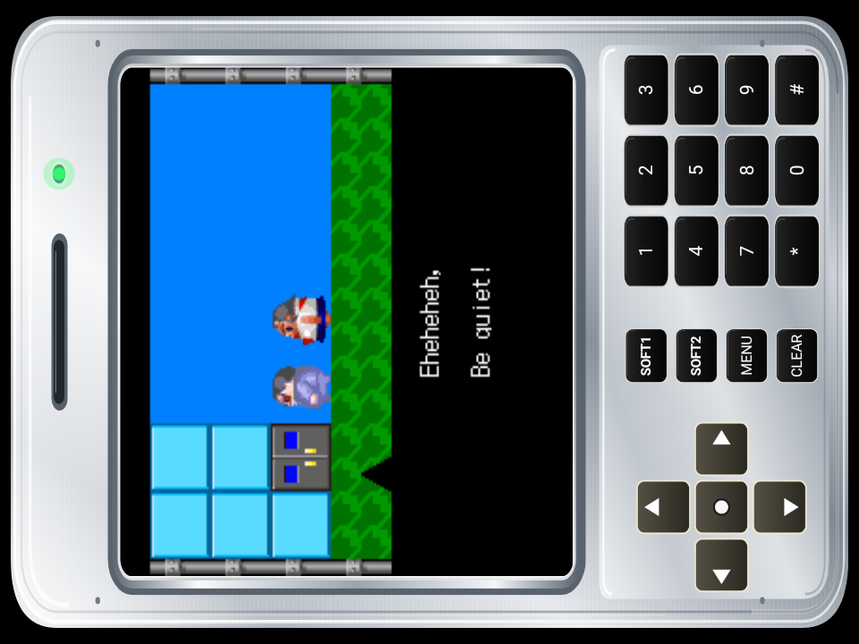



# Pocket DoJa™

**Pocket DoJa** is an Android-based emulator project based on OpenDoJa, dedicated to exploring and preserving the experience of classic NTT DoCoMo i-mode Java games.

The project aims to make these nostalgic mobile games more accessible on modern Android devices, with features including game library management, customizable animated themes, and background music support.

Compatibility may vary depending on the game, DoJa version, and device. Some games or features may not work as expected.
**This is a new emulator, still early/experimental phase, so expect bugs and many games might not work yet, be patient while I'm working at it!**

## Notice

This is a personal hobby project by Shibesan. The only official source of updates is this repository: https://github.com/shibesan-dev

Any social media accounts, websites, or channels claiming to be me or this project outside of the link above are **scams**. Please follow updates here only. Official channels will be listed in this README if they become available in the future.

## 🎮 Game Compatibility

Want to know which DoJa games work with Pocket DoJa?

Check out the **[Game Compatibility Tracker](https://github.com/shibesan-dev/Pocket_DoJa/wiki)** for tested games, compatibility statuses, and known issues.

## Features

- Emulator for classic DoJa / i-mode Java games
- Game library management (`.jam` / `.jar` loading)
- 5 animated themes & skins to choose
- Background music (BGM) support
- Controller / touch input mapping
- Change game icon and rename
- Per-game config (Screen Orientation/Display/Hide Keypad etc)
- GLES1.1 hardware rendering support
- Support for non-touchscreen based device

## Screenshots

| | |
|---|---|
|  |  |
|  |  |
|  |  |
|  |  |

## Building

Requirements:

- Android SDK (compileSdk 34, minSdk 24)
- JDK 17
- Gradle (wrapper included)

Build (debug):

```bash
./gradlew :app:assembleDebug
```

On Windows:

```bat
gradlew.bat :app:assembleDebug
```
## Reporting Issues

Found a bug or something that doesn't work correctly in Pocket DoJa? You can help improve the emulator by submitting an issue on GitHub.

Before creating an issue, please prepare the following:

### 1.  Game Log File

Please attach the log file generated by Pocket DoJa when the problem occurs.

See **[README.md](README.md)** for instructions on how to obtain the log file.

### 2.  Game Screenshot

Please include a screenshot showing the problem whenever possible.

### 3.  Problem Description

Describe the problem in detail. Please include the steps you took to reproduce it so I can try to encounter the same issue.

For example:

1. Open Pocket DoJa.
2. Import and launch the affected game.
3. Navigate to the main menu.
4. Select a particular option.
5. The game freezes after the selection.

Please replace these example steps with what you actually did.

### 4.  Submit a GitHub Issue

Once you have prepared the information:

1. Go to the **[Pocket DoJa Issues](../../issues)** page.
2. Click **New Issue**.
3. Give your issue a clear and descriptive title.
4. Describe the problem and include the steps to reproduce it.
5. Attach your screenshot and game log file.
6. Click **Submit new issue**.

### Information to Include

| Information | Requirement |
|:---|:---|
| Game title | Required |
| Problem description | Required |
| Steps to reproduce | Required |
| Game screenshot | Recommended |
| Pocket DoJa log file | Recommended |
| Device model and Android version | Recommended |

**Thank you for helping improve Pocket DoJa!** Every useful report helps identify problems and improve game compatibility.

## Logging/Debugging

- Enable logging in settings in the emulator.
- Open the game that has issue.
- Go to settings and disable logging.
- The log file is saved in \Android\data\com.shibesan.pocketdoja\ folder.

## Project Structure

- `app/` — Android application module
- `opendoja/` — OpenDoJa host/runtime (Java)
- `dexlib/` — DEX utilities
- `public/` — Themes and assets (game files are *not* distributed)
- `configs/` — Runtime configuration
- `docs/images/` — Screenshots

## Disclaimer

Pocket DoJa does not provide or distribute game files. Users are responsible for obtaining their own files and ensuring their use complies with applicable laws and copyright. Pocket DoJa is not affiliated with or endorsed by NTT DOCOMO, game developers, or publishers. All trademarks belong to their respective owners.

## Credits

- OpenDoJa — For the original project that made Pocket DoJa possible.
- Wandering Hunter (流浪的猎人) — For creating the original Android port.
- Shibesan (aka DominicTei) — The main developer of Pocket DoJa.

## Support the Project

If you enjoy Pocket DoJa and would like to support its continued development, you can make a voluntary donation using one of the options below.

**PayPal:** https://www.paypal.com/ncp/payment/CCLQWPK38LFB4

**Cryptocurrency:**<br>
**Network:** ETH, BSC (BEP-20), and POLYGON based networks are supported!<br>
**Currency:** USDT, BNB, ETH, and POLYGON accepted<br>
**Wallet address:** 0xB3Edf36f3654779ACdE275744a8cC31C37BE9d6c

Donations are entirely optional and help support ongoing development and preservation efforts.

Additionally, feel free to donate to official OpenDoJa team if you want to support the community. <br>
Please visit https://github.com/GrenderG/openDoJa <br>
If you need more information or related resources, <br> 
visit https://keitaiarchive.org/

Thank you for your interest in Pocket DoJa!

© 2026 Pocket DoJa. Original themes, artwork, and branding are owned by the Pocket DoJa developer, except where otherwise stated.

Pocket DoJa is based on OpenDoJa and distributed under GNU GPLv3. Third-party components remain subject to their respective licenses.

Unofficial forks are not necessarily affiliated with or endorsed by the original Pocket DoJa project.
